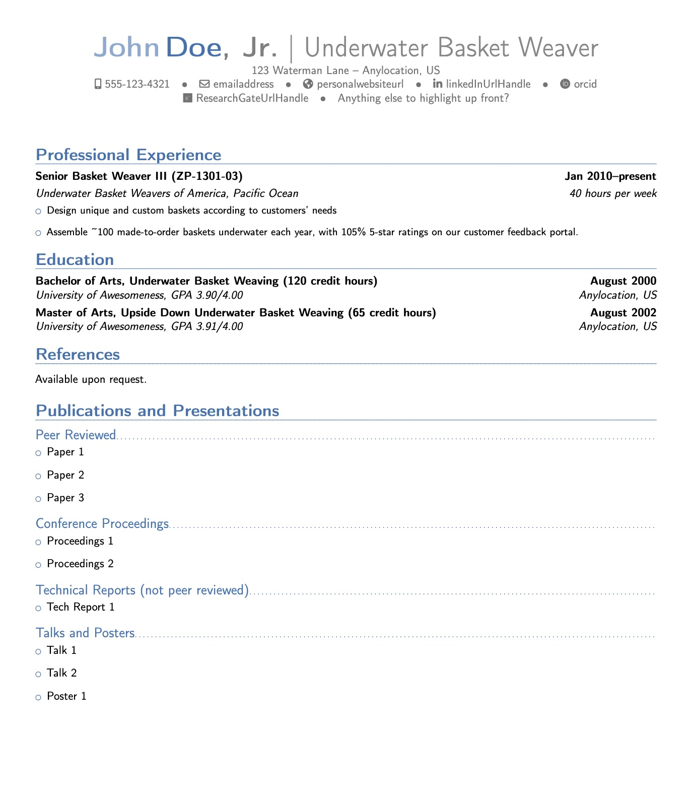
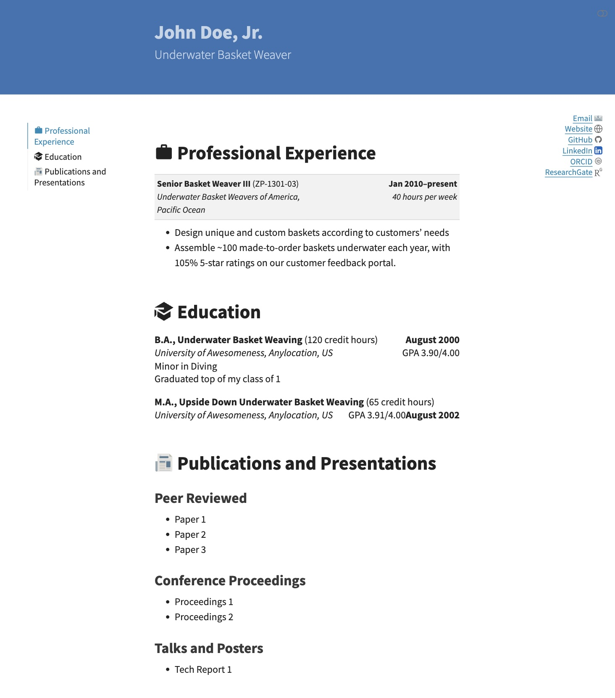

# resume-federal-template

## Federal r&#232;sum&#232; for USAJOBS applications easily generated in `pdf`, `html`, and `docx` formats

### Overview
This template can be used to easily create a [USAJOBS](https://www.usajobs.gov/)-compliant professional federal r&#232;sum&#232; for in `pdf`, `html`, and `docx` formats using [Quarto](https://quarto.org/) and [Python](https://www.python.org/):

* [Quarto](https://quarto.org/docs/get-started/) (>= 1.6.42)
* [Python](https://www.python.org/downloads/) (>= 3.9.6)

The `pdf` version is a custom and limited Quarto implementation of the LaTeX [moderncv](https://ctan.org/pkg/moderncv) template. The implementation is inspired by and derived from the [modern2-cv](https://github.com/schochastics/modern2-cv) Quarto template by [schochastics](https://github.com/schochastics).

The `html` rendering supports integration with a portfolio website. It is based upon [this quarto-resume](https://github.com/busemorose/resume_quarto) by [busemorose](https://github.com/busemorose), but uses Python instead of R to format the content, mostly due to seemingly endless challenges installing R's flextable package.

Credit and kudos to both authors, as well as all upstream template authors, none of whom I know personally. Thank you for your contributions to [open science](https://en.wikipedia.org/wiki/Open_science). This template serves to pay it forward.

The `docx` version is intended to provide a quick and easy way to populate a Microsoft Word document with the same content for occasions when this file format is needed. While the `pdf` and `html` versions are properly and similarly formatted, the `docx` version requires considerable manual intervention after the file is created.

R&egrave;sum&egrave; content is entered in `_contents.yml`. Federal r&egrave;sum&egrave;s differ from private sector r&egrave;sum&egrave;s in that they have very specific content requirements, rules, and expectations. Be sure to fill in all fields in `_contents.yml` to ensure compliance and avoid being deemed ineligible. Layout and formatting customizations can be made in `resume.qmd`. Instructions are provided below.

Note that as of May 2025, the United States Office of Personnel Management (OPM) enforces a strict **two-page limit** on all r&#232;sum&#232;s submitted for federal jobs. Failure to adhere to this limit will result in immediate disqualification. While this template does not enforce this page limit, the mandatory fields and layout do reflect the most recent OPM [guidance on writing federal r&#232;sum&#232;s](https://usajobshelp.opm.gov/hc/en-us/articles/52879511643411-How-to-add-a-resume-to-your-profile) found on USAJOBS.

### Previews

|    PDF     |    HTML    |
|:----------:| :--------: |
|  |  |

### Creating a Federal R&egrave;sum&egrave;

R&egrave;sum&egrave; content is provided in YAML format in `_content.yml`. Templated fields ensure compliance with strict rules outlined on [USAJOBS](https://www.usajobs.gov/). All fields are described below. All entries are strings unless otherwise noted.

All content variables (*e.g.*, education) contain `include-in-resume` Boolean variables that, when `true`, will include that section in the r&egrave;sum&egrave;. If `false` or omitted altogether, the section will not show up in the document. They also include header variables `resume-header` to change the default section headers in all versions of the r&egrave;sum&egrave; simultaneously.

#### Header Information

Header information appears in the banner at the top of the `html` rendering. These include the standard Quarto `title` and `subtitle` top-level YAML arguments:

| Keyword       | Description                                   |
| :------------ | :-------------------------------------------- |
| `title`       | Your full name  for website header            |
| `subtitle`    | Occupation or job title                       |

For example:

```{.yaml filename="_contents.yml"}
---
title: "John Doe"
subtitle: "Underwater Basket Weaver"
---
```

The name displayed at the top of the `pdf` and `docx` files are passed to `author` via second-level `firstname`, `lastname`, and optional `suffix` arguments:

| Keyword       | Description                                   |
| :------------ | :-------------------------------------------- |
| `firstname`   | Your first name for `pdf` and `docx` files    |
| `lastname`    | Your last name for `pdf` and `docx` files     |
| `suffix`      | Optional suffix to follow the name            |

For example:

```yaml
author:
  firstname: "John"
  lastname: "Doe"
  suffix: "Jr."
```

Note that your name needs to be provided twice in `_contents.yml`: to `title` (for `html` and `docx` rendering) and to `author` (for `pdf`), in order for all documents to display properly.

#### Contact Information

Contact information for the top of the r&egrave;sum&egrave; is passed to the top level `content` key, as in `author` above:

| Keyword       | Description                                   |
| :------------ | :-------------------------------------------- |
| `phone`       | Phone number. Required for USAJOBS.           |
| `email`       | Email address. Will generate a "mailto" call if formatted properly as an email address (with an "@" symbol). Required for USAJOBS.  |
| `website`     | URL to personal or professional website       |
| `github`      | Your [GitHub](https://github.com) username only. Will generate the custom web URL directing to this user's dashboard. |
| `linkedin`    | Your [LinkedIn](https://www.linkedin.com/) handle only. Will generate the custom web URL directing to this user's public page. |
| `orcid`       | Your [ORCID](https://orcid.org/) number only.  Will generate the custom web URL directing to this user's public page.|
| `researchgate` | Your [ResearchGate](https://www.researchgate.net/) handle only.  Will generate the custom web URL directing to this user's public page. |
| `extrainfo`   | Any other information to include at the top of the r&egrave;sum&egrave;. For example, desired work locations. |

**Note: OPM prohibits certain information in federal r&egrave;sum&egrave;s, including self-portraits or photos. There have been unverified reports of some applicants being reject for including hyperlinks in their r&egrave;sum&egrave; to professional profiles such as LinkedIn that contain headshots. It is unknown how widespread or common this practice is, but be sure to take this into consideration when populating these fields.**

An optional physical or mailing address can also be passed to the `contact` key. It is separated into `line1` and `line2` keys:

```yaml
contact:
  address:
    line1: "123 Waterman Lane"
    line2: "Anylocation, US"
```

Putting it all together so far:

```yaml
---
title: "John Doe, Jr."
subtitle: "Underwater Basket Weaver"
author:
  firstname: "John"
  lastname: "Doe"
  suffix: "Jr."
contact:
  address: 
    line1: "123 Waterman Lane"
    line2: "Anylocation, US"
  phone: "555-123-4321"
  email: "emailaddress"
  website: "personalwebsiteurl"
  github: "GithubUsername"
  linkedin: "linkedInUrlHandle"
  orcid: "orcid"
  researchgate: "ResearchGateUrlHandle"
  extrainfo: "Anything else to highlight up front?"
---
```

#### Education

**Note: This section, and all of the following sections, are optional when using this template. Omitting the section from `_contents.yml` will prevent it from appearing in the rendered documents. *Optional here does NOT mean optional by OPM requirements!***

Education (*i.e.*, degrees earned) is provided to the `education` category as a list of `items` with the following elements:

| Keyword       | Description                                    |
| :------------ | :--------------------------------------------- |
| `degree`      | Type of degree, written out. Excepted entries: "Bachelor of Science", "Bachelor of Arts", "Master of Science", "Master of Arts", "Doctor of Philosophy". This list can be manually expanded in `moderncv.py`. |
| `major`       | Primary field or area of study of the degree   |
| `minor`       | Secondary field or area of study (optional)    |
| `institution` | Name of the degree-granting institution        |
| `location`    | Location of the institution (city, state)      |
| `date`        | Month and year of degree conferral             |
| `gpa`         | Grade point average. Recommended to format as "x.xx/4.00" |
| `credits`     | Total number of credit hours earned            |
| `extra`       | Extra information, such as awards or relevant coursework |

In addition, the `education` category also takes Boolean control flags specifying whether to include the section as well as a header variable to set the section header:

| Keyword              | Description                                        |
| :------------------- | :------------------------------------------------- |
| `include-in-resume`  | (Boolean) If `true`, this section will appear in the r&egrave;sum&egrave;. If `false` or omitted altogether, it will be excluded. |
| `resume-header`      | Section header text as it should appear in the r&egrave;sum&egrave; |
| `abbreviate-degrees` | (Boolean) If `true`, degree names will be abbreviated (*e.g.*, "Bachelor of Science" will become "B.S.") |

For example:

```yaml
education:
  include-in-resume: true
  resume-header: "Education"
  items:
    - degree: Bachelor of Arts
      major: Underwater Basket Weaving
      minor: Upside Down Underwater Basket Weaving
      institution: University of Awesomeness
      location: Anylocation, US
      date: August 2000
      credits: 120
      gpa: 3.90/4.00
      extra: Graduated top of my class of 1
    - degree: Master of Arts
      major: Upside Down Underwater Basket Weaving
      institution: University of Awesomeness
      location: Anylocation, US
      date: August 2002
      credits: 65
      gpa: 3.91/4.00
```

#### Experience

Professional experience is passed as a list of `items`, as in `education` above, with the following entries:

| Keyword          | Description                                   |
| :--------------- | :-------------------------------------------- |
| `role`           | Job or position title                         |
| `employer`       | Name of employer                              |
| `location`       | Location of employer                          |
| `hours-per-week` | Number of hours worked per week. Required by USAJOBS. |
| `federal-series` | Job series and pay band for federal positions. Required by USAJOBS for any federal position held. (*e.g.*, GS-1301-09) |
| `date`        | Dates of employment (month and year)             |
| `details`     | Description of job duties or accomplishments. This must be a single string, but asterisks (*) will be treated as bullets and will create a list when rendered. See example below. |

In addition, the `experience` category also takes a Boolean control flags specifying whether to include the section as well as a header variable to set the section header:

| Keyword             | Description                                        |
| :------------------ | :------------------------------------------------- |
| `include-in-resume` | (Boolean) If `true`, this section will appear in the r&egrave;sum&egrave;. If `false` or omitted altogether, it will be excluded. |
| `resume-header`     | Section header text as it should appear in the r&egrave;sum&egrave; |

For example:

```yaml
experience:
  include-in-resume: true
  resume-header: Professional Experience
  items:
    - role: Senior Basket Weaver III
      employer: Underwater Basket Weavers of America
      location: Pacific Ocean
      hours-per-week: 40
      federal-series: ZT-1301-02
      date: Jan 2010--present
      details: |
        * Design unique and custom baskets according to customers' needs
        * Assemble ~100 made-to-order baskets underwater each year, with 105% 5-star ratings on our customer feedback portal.
```

#### Certifications

The USAJOBS r&#232;sum&#232; builder contains optional **Certificates and licenses**, **Job-related training**, **Language skills**, and **Additional information** sections. These are implemented here as follows.

Certifications are passed as a list of items called `certification`:

```yaml
certifications:
  resume-header: Certifications
  include-in-resume: true
  items:
    - certification: Open Water Dive Certification
    - certification: Deep Water Dive Certification
```

As above, the section header can be set using `resume-header`, and the section can be excluded altogether by setting `include-in-resume: false`.


#### Trainings

Trainings are be passed as a list of items called `training`:

```yaml
training:
  resume-header: Training
  include-in-resume: true
  items:
    - certification: Specialty weaving techniques
```

As above, the section header can be set using `resume-header`, and the section can be excluded altogether by setting `include-in-resume: false`.

#### Language Proficiencies

Language proficiencies are passed as a list of `items`, as in `education` above, with the following entries:

| Keyword                | Description                                   |
| :--------------------- | :-------------------------------------------- |
| `language`             | Name of language.                             |
| `speaking-proficiency` | Spoken language skill level. Generally one of either "None", "Novice", Intermediate", or "Advanced"                           |
| `writing-proficiency`  | Written language skill level. Generally one of either "None", "Novice", Intermediate", or "Advanced"                           |
| `reading-proficiency`  | Read language skill level. Generally one of either "None", "Novice", Intermediate", or "Advanced"                           |

In addition, the `language` category also takes a Boolean control flags specifying whether to include the section as well as a header variable to set the section header:

| Keyword             | Description                                        |
| :------------------ | :------------------------------------------------- |
| `include-in-resume` | (Boolean) If `true`, this section will appear in the r&egrave;sum&egrave;. If `false` or omitted altogether, it will be excluded. |
| `resume-header`     | Section header text as it should appear in the r&egrave;sum&egrave; |

For example:

```yaml
languages:
  resume-header: Languages
  include-in-resume: true
  items:
    - language: English
      speaking-proficiency: intermediate
      writing-proficiency: novice
      reading-proficiency: advanced
```

#### Extra Information

Extra information can be added using the `extra` key as follows:

```yaml
extra:
  resume-header: Additional Information
  include-in-resume: true
  text: | 
    I can do a lot of things well.

    * Like make resumes
    * And list things I do well
```

As above, the section header can be set using `resume-header`, and the section can be excluded altogether by setting `include-in-resume: false`. Note that this field is treated as a freeform text block. Bulleted and non-bulleted text should be supported, as demonstrated above, but more advanced attempts at formatting may fail without [template modification](#customization).


#### Publications

Four categories of `publications` are supported: `peer-reviewed` for peer-reviewed publications such as journal articles; `proceedings` for conference proceedings; `tech-reports` for non-peer reviewed technical reports; and `talks` for presentations, posters, or contributed abstracts. All categories are passed as lists of `items` with keyword `paper`. Subsection headers can also be set for each sub-category. For example:

```yaml
publications:
  peer-reviewed:
    resume-subheader: "Peer Reviewed"
    items:
      - paper: "Paper 1"
      - paper: "Paper 2"
      - paper: "Paper 3"
```

In addition, the `publications` category also takes a Boolean control flags specifying whether to include the section as well as header and subheader variables to set the section and subsection headers, respectively:

| Keyword             | Description                                        |
| :------------------ | :------------------------------------------------- |
| `include-in-resume` | (Boolean) If `true`, this section will appear in the r&egrave;sum&egrave;. If `false` or omitted altogether, it will be excluded. |
| `resume-header`     | Section header text as it should appear in the r&egrave;sum&egrave; |

Note that these flags are passed to the top level `publications`. The first two flags control the inclusion of the entire publications section in the documents. The categories cannot currently be controlled individually without omitting data from `_contents.yml`. It is currently all or or nothing.

#### Miscellaneous

The r&egrave;sum&egrave; file name can be passed to `resumefilename` (do not include a file extension.) This is used to create hyperlinks to the `pdf` and `docx` files:

```yaml
resumefilename: "my-resume"
```

Page numbers can also be toggled on and off by setting `resume-page-numbers` to either `true` or `false`.

### Customization

#### Rendering `html` and `docx`

R&egrave;sum&egrave; rendering can be customized further in the `resume.qmd` Quarto markdown file. The most important elements to modify are the `output-file` arguments in the front matter under `resume-pdf` and `docx` in `resume.qmd` to specify the name of the r&egrave;sum&egrave; file produced.

The body of these markdown files controls the `html` and `docx` renderings. One may wish to rearrange or add new sections in either document. In addition, any social or web media omitted from the `contact` section in `_contents.yml` should be removed or commented out in these files to prevent errors during rendering if `html` and/or `docx` renderings are desired. The current version of this template does not handle these entries conditionally.

These renderings are constructed using Python functions found in `scripts/moderncv.py`. All functions process subsets of `_contents.yml` passed to an `items` keyword. (Python loads the contents of YAML files as nested dictionaries and lists.) Some functions take additional arguments; these are summarized here but consult the respective docstring for more information.

| Function      | Arguments                 | Usage             |
| :------------ | :------------------------ | :-----------------|
| `mdlist`      | `items`: as described above <br> `bullets`: whether or not to include bullets in the list | Create a simple list of entries. Used for Awards and Publications. |
| `mdeducation` | `items`: as described above <br> `abbrev`: whether or not to always abbreviate degree type | Create a formatted list of degrees for a r&egrave;sum&egrave; |
| `mdexperience`| `items`: as described above | Create a formatted list of professional experiences for a r&egrave;sum&egrave; |

#### Rendering `pdf`

Customizing the `pdf` renderings is somewhat more involved, as it requires knowledge of LaTeX in addition to the Markdown described above. The `pdf` r&egrave;sum&egrave; rendering is templated in `_extensions/schochastics/resume/resumetemplate.tex`. Sections can be added or rearranged in these files, as well as other more advanced customizations, if one knows what one is doing in LaTeX. The advanced user may also find the LaTeX ["moderncv" package documentation](https://ctan.math.washington.edu/tex-archive/macros/latex/contrib/moderncv/manual/moderncv_userguide.pdf) helpful.

### Advanced

As with all Quarto projects, additional modifications can be made in `_quarto.qmd`. This is only needed if one does not like the existing layout or functionality. Generally, this file does not need to be modified.

In addition, a `_website.yml` file is included in case one wishes to convert the `html` rendering into a stand-alone website. Add this file to the `metadata-files` list in the front matter of `resume.qmd` to add navigation bars on the top and left side as well as a footer at the bottom of each page.

### Usage

This repository is configured to publish the `html` renderings to GitHub Pages. This is updated automatically when changes are committed or pushed. The r&egrave;sum&egrave; can be accessed from the landing page and linked to directly from other sites, if desired. Corresponding `pdf` and `docx` files can be downloaded from the `html` page.